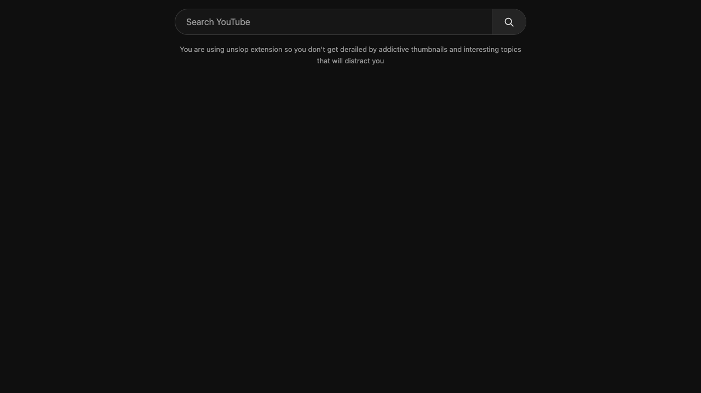

# Unslop YouTube

A small Chrome / Chromium extension that makes YouTube intentional: open the site, search for what you need, choose a video, and leave without getting pulled into the recommendation feed.

YouTube's thumbnails and endless interesting topics make it easy to get sidetracked. Unslop hides the feed and recommendations, leaving a search bar and a reminder of why you opened a quieter version of YouTube:

> You are using unslop extension so you don't get derailed by addictive thumbnails and interesting topics that will distract you

Built for personal use and shared publicly so anyone can load it locally. No account, build step, analytics, or remote code.

## How to install in your browser

Use desktop **Google Chrome**, **Microsoft Edge**, or **Brave**.

1. On this GitHub page, click the green **Code** button → **Download ZIP**.
2. Extract the downloaded ZIP. Keep the extracted folder somewhere permanent; the browser loads the extension from that folder.
3. Open a new browser tab, paste the address for your browser into the address bar, and press Enter:
   - **Chrome:** `chrome://extensions`
   - **Edge:** `edge://extensions`
   - **Brave:** `brave://extensions`
4. Turn on **Developer mode** on that page.
5. Click **Load unpacked** and select the extracted `unslop-youtube-main` folder (the folder containing `manifest.json`).
6. Open [YouTube](https://www.youtube.com/) or refresh an existing YouTube tab. You should see the search bar and focus reminder.

To access the on/off switch easily, open your browser's **Extensions** menu (the puzzle-piece icon) and pin **Unslop YouTube**. Click its icon to toggle **Quiet mode**.

No terminal commands or build step are needed. These instructions are for desktop Chromium browsers; Safari and Firefox installation is not included.

## Behavior

- Homepage, subscriptions, and channel pages: a search bar and the focus reminder on a dark background. Hidden media is paused.
- Selected Shorts open in the normal video player, so you can watch the one you chose without entering the endless Shorts feed.
- Search: results for your query remain available. Shorts shelves and promoted result cards are hidden.
- Watch: the video you choose remains available, with no recommendation sidebar, comments, live chat, or end-screen suggestion cards. The next-video autoplay switch is turned off when available.
- The popup's **Quiet mode** switch restores the ordinary page immediately, across open YouTube tabs.
- Your preference is saved locally. The only extension permission is `storage`; content scripts run only on YouTube. No information is sent anywhere by the extension. Submitting a search uses YouTube normally.

This hides page elements; it does not block video ads or YouTube's network requests. Some YouTube experiments may require future selector updates. Use the toggle temporarily if you need a hidden channel page, sign-in control, consent dialog, or other native UI. Turning quiet mode off does not restore YouTube's previous autoplay setting.

To update after editing files, click **Reload** on the extension card, then refresh YouTube. To uninstall, click **Remove** on the extension card.

Implementation follows Chrome's static content-script model: https://developer.chrome.com/docs/extensions/develop/concepts/content-scripts
